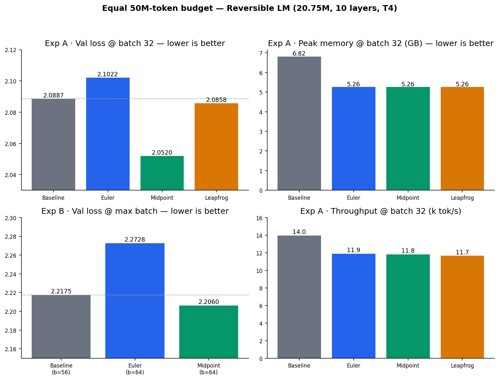
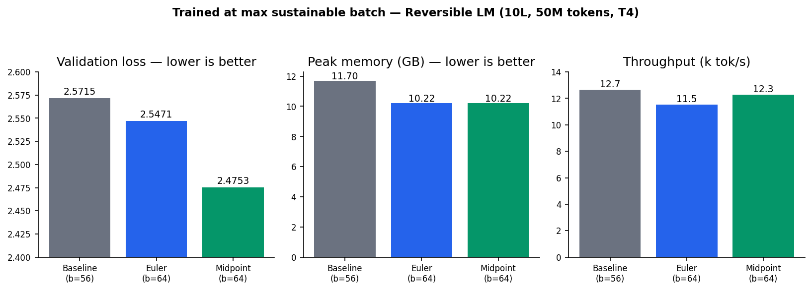

# Reversible Language Models: Memory-Efficient Training with Reversible Integrators

A from-scratch PyTorch study of a standard transformer LM against **reversible**
variants (Euler / midpoint / leapfrog) — the **midpoint** variant matches baseline
quality at **~23% lower activation memory**.

Reversible layers are cast as time-reversible ODE integrators (after **Karami et
al., arXiv:2512.02056**): hidden states are *reconstructed* during backprop rather
than stored, so activation memory is nearly independent of depth — at the cost of
one extra forward evaluation per layer.

## Results

20.75M params · 10 layers · d_model 256 · 50M-token corpus (TinyStories, GPT-2 BPE) · NVIDIA T4.
Headline numbers are the **token-matched** runs — every arm trained on an equal **50M tokens**
(Experiment 3). Memory and max-batch come from the fixed-batch run + OOM sweep (Experiment 1),
which the token-accounting correction does not affect.

| Config | Val loss (50M, equal budget) | Peak mem @ b32 (GB) | Tokens/sec @ b32 | Max stable batch |
|---|---|---|---|---|
| Baseline | 2.0887 | 6.819 | 13,959 | 56 |
| Euler | 2.1022 | 5.258 | 11,887 | 64 |
| **Midpoint** | **2.0520** | **5.258** | 11,827 | **64** |
| Leapfrog | 2.0858 | 5.258 | 11,657 | — |



- **Memory:** reversible variants use **22.9% less** peak memory at fixed batch
  (5.26 vs 6.82 GB). Unaffected by the token correction.
- **Quality (token-matched):** at an equal 50M-token budget and equal batch,
  **midpoint has the lowest loss — 2.0520, below the baseline's 2.0887**. Reversibility
  costs no accuracy and midpoint modestly helps.
- **Throughput:** 9–11% slower at fixed batch (the extra recompute). The batch-size gain
  (56→64) is too small at 10 layers to convert into a throughput win; the effect **grows
  with depth** (the paper reaches ~10× batch / ~2× throughput at 96 layers).
- **Max batch:** reversible fits **64 vs the baseline's 56** (OOM sweep).

Full write-up in [`REPORT.md`](REPORT.md); method deep-dives in [`NOTES.md`](NOTES.md).

## Files

```
model.py             GPT with baseline + euler/midpoint/leapfrog + reversible autograd
data.py              tokenize ~50M tokens -> train.bin / val.bin (GPT-2 BPE)
train.py             training loop, logs metrics to results.jsonl
sweep.py             doubles batch until OOM -> reports max stable batch
test_reversible.py   correctness checks (invertibility + grad equivalence)
reversible_llm_colab.ipynb       Colab runner — fixed-batch comparison + OOM sweep
reversible_llm_colab_run.ipynb   the above, executed on a T4 (with output logs)
max_batch_experiment.ipynb       Colab runner — training at max sustainable batch
equal_token_budget_experiment.ipynb  Colab runner — all arms to an equal 50M-token budget
```

## Three experiments

1. **Fixed-batch comparison** (`reversible_llm_colab.ipynb`) — all four configs at the
   same batch (32), plus a max-stable-batch OOM sweep. *Its memory and max-batch results are
   valid and used above; its loss comparison (16.4M tokens) is superseded by Experiment 3.*
2. **Max-batch training** (`max_batch_experiment.ipynb`) — each arm at its own max stable
   batch. *Kept for transparency: its loss comparison is confounded (arms saw unequal tokens,
   28.7M vs 32.8M) and is superseded by Experiment 3's token-fair version; memory/throughput
   at max batch are still valid.*

   | Config | Batch | Val loss | Peak mem (GB) | Tokens/sec |
   |---|---|---|---|---|
   | Baseline | 56 | 2.5715 | 11.698 | 12,651 |
   | Euler | 64 | 2.5471 | 10.221 | 11,517 |
   | **Midpoint** | 64 | **2.4753** | 10.221 | 12,261 |

   At max batch the reversible arms show lower loss at lower memory — but this is **not a
   token-matched comparison** (baseline sees 28.7M tokens, reversible 32.8M, from the fixed
   2000 steps), so the loss gap here is partly just more data seen. The memory / max-batch
   findings hold; the accuracy claim is re-tested in Experiment 3.
   

3. **Equal token-budget** (`equal_token_budget_experiment.ipynb`) — *correction per mentor
   feedback.* Every arm trained to the **same 50M tokens** (`--target_tokens`; iters auto-set
   per batch 32→6104 / 56→3488 / 64→3052), so any accuracy difference is attributable to the
   method, not to data seen. **This is the authoritative accuracy comparison.**

   Experiment A — equal batch (32), 50M tokens:

   | Config | Val loss | Peak mem (GB) | Tokens/sec |
   |---|---|---|---|
   | Baseline | 2.0887 | 6.819 | 13,959 |
   | Euler | 2.1022 | 5.258 | 11,887 |
   | **Midpoint** | **2.0520** | 5.258 | 11,827 |
   | Leapfrog | 2.0858 | 5.258 | 11,657 |

   Token-matched, **midpoint still beats baseline on loss** (2.0520 vs 2.0887) at 22.9% lower
   memory. The gap is smaller than the uncontrolled runs implied, but the direction holds:
   reversibility costs no accuracy and midpoint modestly helps. 

   *Disconnect-proof:* `train.py --ckpt_dir` checkpoints to Drive every 1000 iters and auto-resumes (`[resume] ...`) if a run is interrupted, deleting the checkpoint on completion — so a dropped Colab session never loses an in-flight run.

## The integrators

`f(p)` is one layer's function (Attn + MLP, pre-norm). Two coupled full-width
streams are carried; all configs have the **same parameter count** as the baseline.

| `--coupling` | Forward rule | Reverse (backward reconstruction) |
|---|---|---|
| `none` | `p = p_prev + f(p_prev)` (standard) | not reversible — stores activations |
| `euler` | `q = q_prev + Attn(LN p_prev)`;  `p = p_prev + MLP(LN q)` | `p_prev = p − MLP(LN q)`;  `q_prev = q − Attn(LN p_prev)` |
| `midpoint` | `p⁺ = p⁻ + 2h·f(p)` | `p⁻ = p⁺ − 2h·f(p)` |
| `leapfrog` | `p⁺ = 2p − p⁻ + h²·f(p)` | `p⁻ = 2p − p⁺ + h²·f(p)` |

The block is evaluated at the **intermediate** state `p` (which the backward pass
already holds); a standard block evaluates `f` at the state it's trying to recover,
so it can't be inverted without storing the input. `h` is the step size (`--h`,
default 0.5); the scheme is only marginally stable, so tune `h` if training diverges.

## Reproduce

```bash
pip install -r requirements.txt
python test_reversible.py                       # inverses exact, grads match autograd
python data.py --tokens 50_000_000              # -> data/train.bin, val.bin

python train.py --coupling none     --batch_size 32 --max_iters 2000 --eval_val
python train.py --coupling euler    --batch_size 32 --max_iters 2000 --eval_val
python train.py --coupling midpoint --batch_size 32 --max_iters 2000 --eval_val
python train.py --coupling leapfrog --batch_size 32 --max_iters 2000 --eval_val

python sweep.py --coupling none                 # max-batch (OOM) sweep
python sweep.py --coupling euler
python sweep.py --coupling midpoint
```

No GPU locally? Use `reversible_llm_colab.ipynb` (set runtime to GPU, Run all).
Keep `--max_iters` and `--seq_len` identical across runs — only change `--coupling`.

### Execution environment

All results in this repo were produced on **Google Colab, NVIDIA T4 (16 GB)**,
PyTorch 2.x + CUDA, bf16 autocast. Data: **50M tokens** of TinyStories via GPT-2
BPE (47.5M train / 2.5M val). The executed notebook with full run logs (GPU check,
correctness checks, per-run loss + `RESULT` lines, OOM sweep, results table) is
[`reversible_llm_colab_run.ipynb`](reversible_llm_colab_run.ipynb);
[`reversible_llm_colab.ipynb`](reversible_llm_colab.ipynb) is the clean,
output-free runner for re-execution.

## Constraints
- **Dropout must be 0** for reversible modes — the backward recomputes `f`, and a
  random dropout mask would make the reconstruction differ from the forward pass.
  The code enforces this when `coupling != none`.
- **Marginal stability** — the step size `h` sits in a narrow stable range.
- `peak_mem_gb` is only meaningful on CUDA (`torch.cuda.max_memory_allocated`).

## Reference
Karami et al., *Reversing Large Language Models for Efficient Training and
Fine-Tuning*, arXiv:2512.02056.
