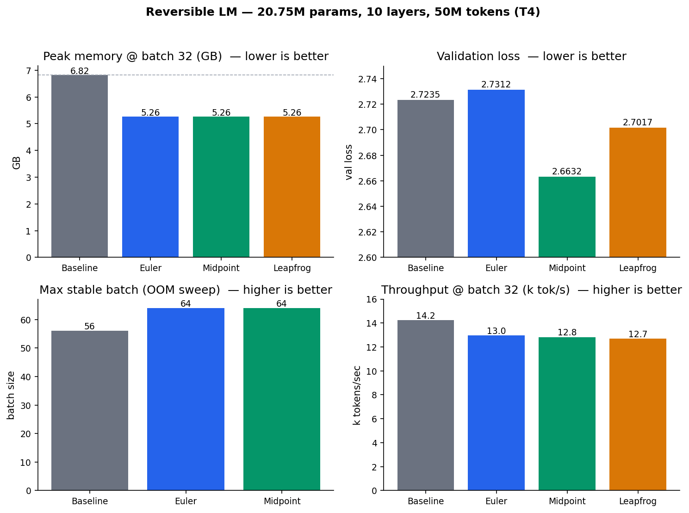

# Reversible Language Models — Training Report

## 1. Objective

Train a ~20M-parameter language model on ~50M tokens and compare a standard
(non-reversible) baseline against reversible variants (Euler / midpoint, plus a
leapfrog variant), measuring the effect of reversibility on peak memory,
throughput, final loss, and the maximum stable batch size, and identifying which
variant performs best.

Reversibility follows **Karami et al., "Reversing Large Language Models for
Efficient Training and Fine-Tuning" (arXiv:2512.02056)**: reversible layers cast
as time-reversible ODE integrators, reconstructing hidden states during backprop
instead of storing them.

---

## 2. Experiment Setup

Identical across all runs so the comparison is clean:

| Item | Value |
|---|---|
| Model params | 20.75M (identical for all 4 configs) |
| Dataset | TinyStories (GPT-2 BPE) |
| Total tokens | 50M (47.5M train / 2.5M val) |
| Sequence length | 256 |
| Layers / d_model / heads | 10 / 256 / 8 |
| Optimizer / LR | AdamW, 3e-4, cosine decay, 100 warmup |
| Betas / weight decay | (0.9, 0.95) / 0.1 |
| Training steps | 2000 (same for all runs) |
| Batch size (fixed runs) | 32 |
| Precision | bf16 autocast |
| Dropout | 0 (required for exact reconstruction) |
| Integrator step h | 0.5 (midpoint uses 2h, leapfrog h²) |
| GPU | NVIDIA T4 (16GB, Colab) |
| Seed | 1337 |

Batch-size sweep method: double the batch from 8 until CUDA OOM, then binary
back-off to the exact ceiling (`sweep.py`).

---

## 3. Run Configurations

| Run | Reversible? | Integrator | Params |
|---|---|---|---|
| A — Baseline | No | — (standard pre-norm) | 20.75M |
| B — Euler | Yes | Hamiltonian coupling (1st order) | 20.75M |
| C — Midpoint | Yes | `p⁺ = p⁻ + 2h·f(p)` | 20.75M |
| D — Leapfrog | Yes | `p⁺ = 2p − p⁻ + h²·f(p)` | 20.75M |

---

## 4. Results

### Fixed batch (32), 2000 steps

| Run | Final train loss | Val loss | Tokens/sec | Peak memory (GB) |
|---|---|---|---|---|
| A — Baseline | 2.8213 | 2.7235 | 14,230 | 6.819 |
| B — Euler | 2.8370 | 2.7312 | 12,962 | 5.258 |
| C — Midpoint | **2.7669** | **2.6632** | 12,830 | 5.258 |
| D — Leapfrog | 2.8094 | 2.7017 | 12,689 | 5.258 |

### Max stable batch (OOM sweep)

| Run | Max stable batch | Peak memory at max (GB) | Tokens/sec at max |
|---|---|---|---|
| A — Baseline | 56 | 11.699 | 14,190 |
| B — Euler | 64 | 10.221 | 13,200 |
| C — Midpoint | 64 | 10.221 | 13,003 |



---

## 5. Analysis

**Memory.** At a fixed batch of 32, all three reversible variants used **5.258 GB
vs the baseline's 6.819 GB — a 22.9% reduction**. Fitting a per-sample memory
line across the fixed-batch and max-batch points gives 0.155 GB/sample for
reversible vs 0.203 GB/sample for baseline: reversible activations cost **23.7%
less per sample**, consistent with the fixed-batch figure. The saving is real and
reproducible but modest, because at only 10 layers the recomputed activations are
a limited share of total memory (weights, optimizer state, embeddings and the
50257-row output projection are fixed overhead that reversibility doesn't touch).

**Max batch size.** Reversible fit **batch 64 vs the baseline's 56 (1.14×)**.
This is far below the paper's ~10×, and the reason is depth: the paper's headline
used 96 layers, where activation memory dominates and removing it frees most of
the budget. At 10 layers the fixed overhead dilutes the gain. Notably reversible
at batch 64 (10.22 GB) still used *less* memory than the baseline at batch 56
(11.70 GB) — it had headroom the baseline lacked.

**Throughput.** At fixed batch the reversible variants were **9–11% slower**
(≈12.7–13.0k vs 14.2k tok/s) — the cost of the extra forward evaluation each
backward pass. Because the batch-size gain here is small, that saved memory did
not convert into a throughput win (the mechanism behind the paper's ~2× speed-up).
At this depth reversibility is a memory technique, not a speed technique.

**Euler vs midpoint (and leapfrog).** **Midpoint was the best variant**, reaching
the lowest loss of all four — val 2.6632, *below* the baseline's 2.7235 (−0.060)
— confirming the paper's finding that reversibility is "comparable or slightly
better," and that the symmetric 2nd-order-accurate midpoint integrator can even
help optimization. Ordering by val loss: **midpoint (2.6632) < leapfrog (2.7017)
< baseline (2.7235) < euler (2.7312)**. Euler was marginally worse than baseline
(+0.008, within run-to-run noise); the two multi-step schemes (midpoint, leapfrog)
both beat baseline. All ran stably at h = 0.5 with no divergence.

**Surprises / gotchas.** (1) All reversible variants report identical peak memory
because the memory is dominated by the recompute footprint, which is the same
across schemes. (2) The OOM ceiling is slightly fragmentation-dependent, so the
batch *ratio* is the robust number, not the absolute value. (3) Dropout had to be
0 — a random mask would break exact reconstruction.

---

## 6. Conclusions

- **Best variant: midpoint** — lowest train and val loss (val 2.6632, beating the
  baseline), same 22.9% memory saving as the other reversible schemes, and stable
  training. It gives the best loss *and* the memory benefit.
- **Reversibility for the upcoming B200 training targets: yes, with scale.** At
  10 layers the memory win is modest (23%) and doesn't yet pay off in throughput.
  But the benefit grows with depth — the paper's ~10× batch and ~2× throughput
  come at 96 layers — so for the deep models planned on B200 hardware, reversible
  layers (midpoint) are the right choice: they enable much larger batches within
  a fixed memory budget at no loss in quality, and turn that into real throughput
  once activation memory dominates.

---

## 7. Appendix

### Commands used
```bash
python data.py --tokens 50_000_000
python train.py --coupling none     --batch_size 32 --max_iters 2000 --eval_val
python train.py --coupling euler    --batch_size 32 --max_iters 2000 --eval_val
python train.py --coupling midpoint --batch_size 32 --max_iters 2000 --eval_val
python train.py --coupling leapfrog --batch_size 32 --max_iters 2000 --eval_val
python sweep.py --coupling none
python sweep.py --coupling euler
python sweep.py --coupling midpoint
```

### Key config
10 layers, d_model 256, 8 heads, mlp_ratio 4, seq_len 256, GPT-2 BPE (vocab 50257),
AdamW lr 3e-4 cosine, weight decay 0.1, bf16, dropout 0, integrator step h = 0.5,
seed 1337, NVIDIA T4.

### Correctness (test_reversible.py)
Inverses exact to ~1e-7; reversible custom-backward gradients match plain autograd
to ~1e-8; all four configs have identical parameter counts; reversible forward
stores no intermediate autograd graph.
